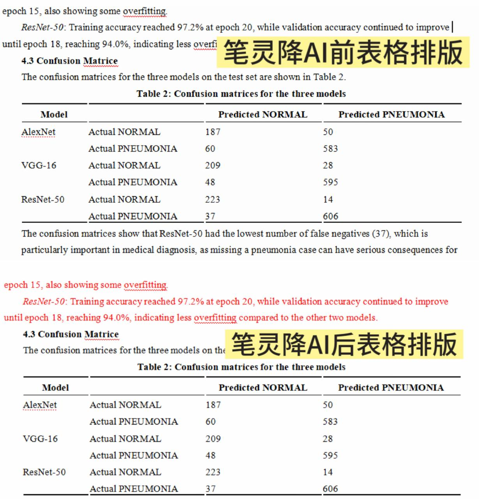

# 英文AI率太高怎么办？英文降 ai 率 4 个实操方法 \+ 工具横向实测

2026 年还在写英文论文的小伙伴一定要留意，新版**turnitin**文本识别机制已经升级，不再只盯着文字重复率。如果依旧使用老办法单纯替换同义词，**英文 ai 率检测**结果很难有改善，在 ZeroGPT、Copyleaks、Originality 这类**AI Checker**复测依旧飘蓝，很难完成 **Humanize AI**。

最近很多留学生私信问我**论文 AI 痕迹超标**怎么办，其实不必过度焦虑。这段时间我整理了一套最新**英文降 ai 率**实操办法，同时实测多款**英文 aigc 检测免费**网站、免费改写工具与专业改写平台，今天来和大家分享一下～

## 一、新版 Turnitin 主要识别这 3 类文本特征

**1、句式太规整，缺少长短变化**

AI 生成的文本经常会出现句式相似的情况，句子长度也比较平均，整篇文章读起来很工整，却少了些自然的节奏变化。这也是 **turnitin** 和各类 **AI Checker** 在分析文本时会关注的特征之一。

**2、内容偏重结论，缺少具体的思考过程**

机器生成的内容往往会直接给出观点和结论，却很少写到阅读文献时的思考，或是研究过程中一步步分析的细节。少了这些带有个人特点的内容，文章读起来就容易显得比较套路化。

**3、段落结构相似，过渡表达比较固定**

**AI 写作**在组织内容时，容易出现相似的行文结构，段落之间的衔接也常常使用重复的过渡词句。如果整篇文章都按照类似的模式展开，就容易显得缺乏变化，这也是修改文稿时可以留意的地方。

## 二、4 个高阶英文文稿优化方法

**方法 1 ：段落重述改写** 

修改时，先通读完整段落，吃透段落核心观点，合上原文，按照自己的理解重新复述表达。 这种方式能够重构整段逻辑框架，在所有**英文降 ai 率**手段里，效果最稳定持久。

**方法 2 ：填充研究细节法** 

针对文稿的数据分析、文献评述部分，适当补充你的思考或者研究过程描述。AI 很难写出带有个人视角的细节，加入这类内容之后，文本真人感更强，Humanize AI 的效果维持更稳定。 举例：

> 原句 ：The analysis shows significant differences between two groups\.
> 
> 改写后：After filtering outliers from raw experimental data, the statistical analysis reveals notable differences between the two sample groups\.
> 
> 

**方法 3 ：句式打散重组 **

专门挑结构过于工整的长复合句拆分，拆成 2\-3 个短句；如果段落全是零散短句，也可以酌情合并。 不需要整篇文章全部重写，优先修改模板感突出的句子，就能打破 AI 固有的句式规律，减少 AIGC 痕**迹。**

**方法 4 ：学术语气微调 **

替换文稿内过于刻板的书面套话，微调部分连接词。调整的时候要注意保护专业术语，不能为了降 AI 率破坏论文本身的学术严谨性。

## 三、多款英文文本优化工具实测盘点

上面 4 套手动技巧，适合有时间、愿意逐段打磨文稿的同学。 但如果论文篇幅很长、临近 DDL，纯手动修改会耗费大量精力。我陆续测试多款文本优化工具，客观聊聊真实使用感受。

### 01、笔灵 AI

传送门：[笔灵英文降ai ](https://ibiling.cn/paper-pass/english?from=githubywjiangai1009jw)[https://ibiling\.cn/paper\-pass/english](https://ibiling.cn/paper-pass/english?from=githubywjiangai1009jw)

笔灵是我实测下来适配英文长篇学术文稿的**英文降 ai 率**工具，优化后文本自然度表现稳定。前后试过很多改写工具对比，笔灵的体验差异很明显。

市面上大量改写工具只会机械替换单词，经常出现上下文脱节、专业名词出错的问题。笔灵会通读全文、理解完整上下文之后再重构句式，弱化 AIGC 痕迹更加自然，Humanize AI 效果突出。

我最常用的就是固定词锁定功能，专业名词、实验数据、文献引用等关键内容都可以提前锁定。锁定后工具只会优化语句表达，不用担心核心学术内容被随意改动。 

还有一个很省心的优势：文稿自带表格、注释、原有段落排版可以完整保留，不用导出之后手动重新排版。很多同类工具改写之后表格直接错乱，复原格式会消耗大量时间，用笔灵能省下排版精力，让我们专注打磨论文内容。

### 02、SpeedAI

SpeedAI 上手门槛低，改写响应速度快，自带简易**英文 ai 率检测**，适合临时救急，处理短句、小段文本基础润色。很多新手搜索**免费在线查 ai 率英文**工具时，很容易找到它。 

短板也很突出，仅支持基础长句拆分、简单换词，改动停留在表层。 如果整篇文稿机器感很重，改写之后底层行文逻辑没有变化，复测**英文 ai 率检测**分数改善有限。更适合作为备用工具微调短文本，不适合作为长篇论文主力改稿软件。

### 03、降重鸟

新用户注册赠送免费试用额度，主打英文基础润色，轻量化**英文降 ai 率**工具。 实测改写句子通顺，语法出错概率低，基础调换语序、替换单词都能实现。 

局限是改写深度不足，面对 AI 高频长复合从句很难彻底拆解，无法从根源消除模板行文习惯。如果文稿 AI 痕迹很重，单独使用效果有限，适合搭配主力工具打磨表层文字细节。

## 写在最后

2026 年做**英文降 ai 率**，重点不是疯狂替换单词，核心在于调整行文语感、重构句式，增加属于自己的个人写作印记。 不要指望单一工具一步到位，最好手动微调搭配工具辅助。

找到适配的**英文降 ai 率**方法，合理组合工具，慢慢打磨，就能写出流畅自然、AI 痕迹低的英文文稿。工具只作为辅助，论文的观点、论证逻辑依旧要自己把控，遵守学校学术诚信要求。

